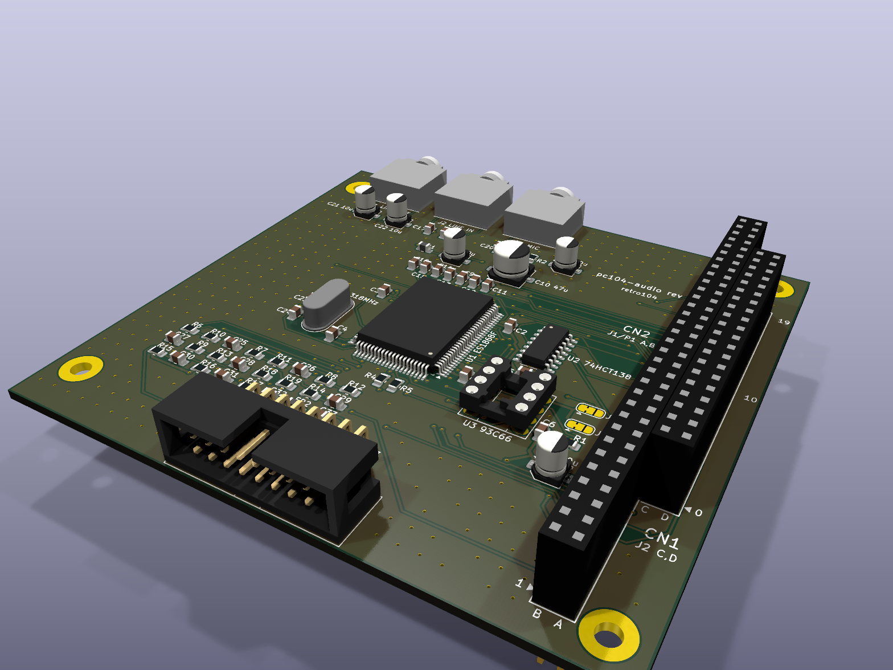
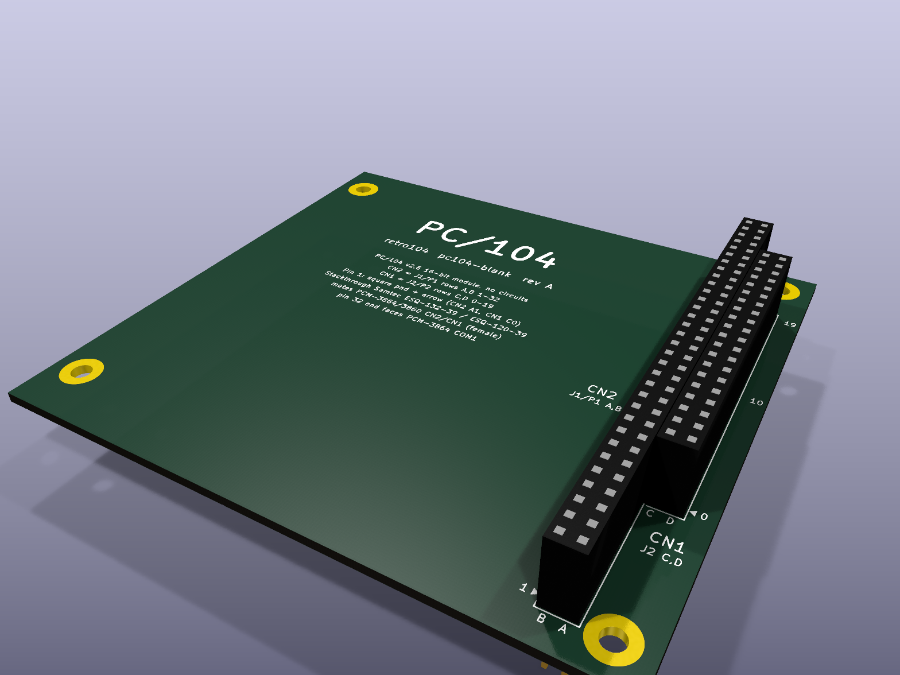
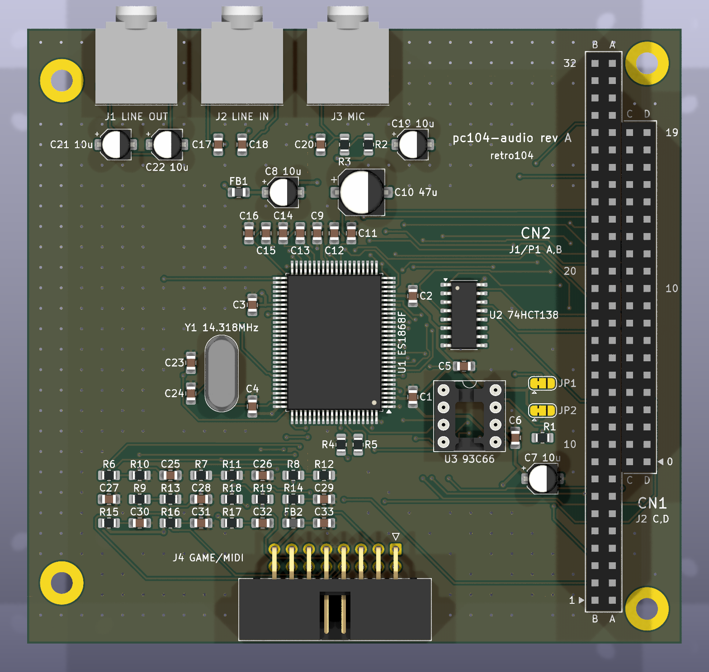
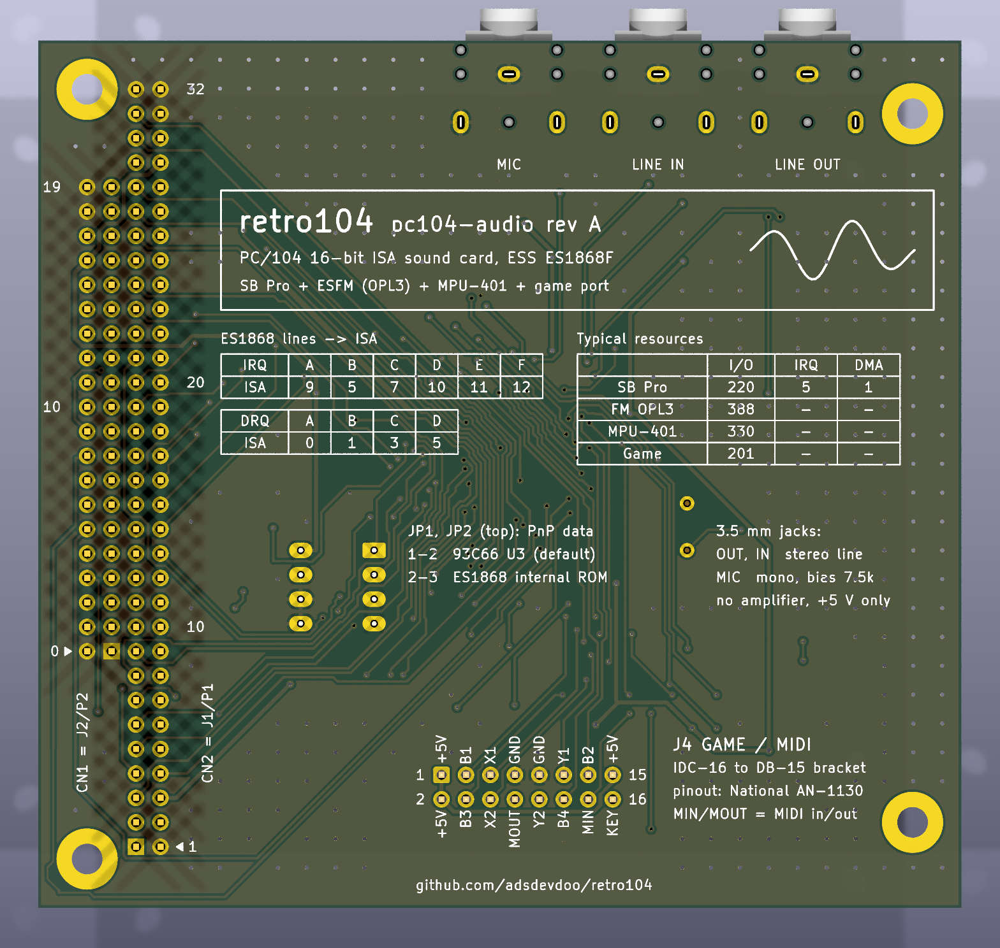

# retro104

Платы расширения **PC/104** (шина ISA 8/16 бит) для ретро-одноплатников. Первый хост —
Advantech **PCM-3860/64 Rev.A1** с видеоконтроллером C&T F65545, то есть вариант **PCM-3864**
(386SX-40, плата 145 × 102 мм с разъёмами PC/104 CN1/CN2).

| pc104-audio — звуковая карта | pc104-blank — механическая ответка |
|---|---|
|  |  |

| Этап | Плата | Состояние |
|---|---|---|
| 1 | [`pc104-blank`](hardware/pc104-blank/) — пустая механическая ответка | **rev A: ERC 0, DRC 0, контакты сверены 104/104, Gerber проверены. Не изготовлена** |
| 2 | [`pc104-audio`](hardware/pc104-audio/) — звуковая карта на ESS ES1868F (донор BTC 1853L) | **rev A: ERC 0, нетлист сверен, разведена, DRC 0, Gerber проверены. Не изготовлена** |
| 3 | Ethernet | не начата |

**Статус: инженерные прототипы, не изготавливались и в железе не проверялись.**
Заказ, оплату и загрузку файлов в JLCPCB выполняет владелец.

## pc104-audio — звуковая карта

Модуль PC/104 16 бит на **ESS ES1868F** с донорской карты BTC 1853L: Sound Blaster Pro 3.01,
FM-синтез ESFM (совместим с OPL3 по регистрам), MPU-401 UART и game port. Схема повторяет типовое
включение ESS (даташит ES1868, прил. B) с решениями владельца ([audio-options.md](docs/audio-options.md)).

- **Звук:** линейный выход, линейный вход, микрофон — гнёзда 3.5 мм Same Sky SJ1-3523N на верхнем
  крае, который при установке смотрит в сторону COM1 хоста. Усилителя нет.
- **Game/MIDI:** угловой IDC 2 × 8 на нижнем крае под стандартный кабель с планкой DB-15
  (раскладка National AN-1130). Вертикальный разъём с кабелем не проходит по высоте PC/104.
- **С донора:** ES1868F, EEPROM 93C66 (в панели, данные PnP) и при желании 74LS138. Кварц
  14.31818 МГц — низкий HC-49/S; донорский HC-49/U ставится только лёжа.
- **Питание:** только +5 В шины, аналоговая часть — через феррит.

| ES1868 | IRQA | IRQB | IRQC | IRQD | IRQE | IRQF | DRQA | DRQB | DRQC | DRQD |
|---|---|---|---|---|---|---|---|---|---|---|
| Линия ISA | 9 | 5 | 7 | 10 | 11 | 12 | 0 | 1 | 3 | 5 |

Раскладка — как у ESS и в EEPROM типовых карт, поэтому 93C66 донора подходит без перепрошивки.
Рекомендуемые ресурсы на PCM-3864: SB 220h / IRQ5 / DMA1, MPU-401 330h, FM 388h, джойстик 201h;
LPT хоста — на IRQ7. Подробно — [docs/pc104-audio.md](docs/pc104-audio.md).



<details>
<summary>Низ платы: название, таблицы IRQ/DRQ и ресурсов, перемычки, выводы J4 на шелкографии</summary>



</details>

Плата 95.89 × 90.17 мм, 2 слоя. Сигналы 0.25 мм, питание 0.4 мм, земля залита с двух сторон и
сшита. Трассировка — FreeRouting 2.5.0. На шелкографии верха обозначения всех деталей, у микросхем,
кварца и электролитов — номиналы. Архив для заказа:
[hardware/pc104-audio/fabrication/](hardware/pc104-audio/fabrication/).

## pc104-blank — механическая ответка

Электрически пустой модуль PC/104: только площадки разъёмов CN1/CN2 и четыре крепёжных отверстия.
На нём проверяются габарит, отверстия, ориентация и сопряжение разъёмов с PCM-3864. Контур,
отверстия и CN1/CN2 звуковой карты взяты отсюда.

| Параметр | CN2 | CN1 |
|---|---|---|
| По стандарту PC/104 | J1/P1, ряды A/B, контакты 1–32 | J2/P2, ряды C/D, контакты 0–19 |
| На PCM-3864 (с. 67 руководства) | CN2, 64 контакта | CN1, 40 контактов («Row A/B» = C/D) |
| Разъём | Samtec **ESQ-132-39-G-D** | Samtec **ESQ-120-39-G-D** |
| Тип | проходной (stackthrough): гнездо сверху, штыри снизу | то же |
| Корпус над платой / штырь под корпусом | 11.05 мм / 12.19 мм, квадрат 0.64 мм | то же |
| Отверстие / площадка | 1.02 мм (Samtec ESQ-SDT) / 1.70 мм | то же |
| Pin 1 (квадратная площадка, стрелка) | A1 | C0 |
| Положение, PC/104 рис. 3 | A: X 0.400 in, B: X 0.500 in; A1 в Y 0.250 in | C: X 0.300 in, D: X 0.200 in; C0 в Y 1.050 in |
| Ключевая позиция стандарта | B10 (у Advantech — GND) | C19 (у Advantech — N/C) |

Плата 3.775 × 3.550 in (95.89 × 90.17 мм), отверстия Ø3.18 мм с площадкой Ø6.35 мм:
(0.200; 0.200), (0.200; 3.350), (3.575; 0.350), (3.575; 3.250) in.

**Переходник не нужен.** Разъёмы PCM-3864 — гнёзда (руководство с. 58–59), а у модулей retro104 снизу
штыри проходных разъёмов. Переходник «male-male» Advantech нужен только модулю, у которого снизу тоже
гнёзда. Конец разъёмов с pin 32 / pin 19 при установке смотрит в сторону COM1 хоста.

| Верх | Сопряжение с гнёздами хоста (иллюстративные модели) |
|---|---|
|  |  |

## Документация

| Файл | Что внутри |
|---|---|
| [docs/pc104-audio.md](docs/pc104-audio.md) | звуковая карта: схема, IRQ/DMA, разъём game/MIDI, проверки, первая настройка |
| [docs/audio-options.md](docs/audio-options.md) | варианты звуковой карты, донор BTC 1853L, решения владельца |
| [docs/pc104-audio-schematic.pdf](docs/pc104-audio-schematic.pdf), [docs/pc104-audio-assembly.pdf](docs/pc104-audio-assembly.pdf) | схема и сборочный чертёж звуковой карты |
| [docs/mechanics.md](docs/mechanics.md) | механика PC/104 со ссылками на страницы, неоднозначности руководства, сверка с фото, переходник |
| [hardware/pc104-blank/reports/pinout-check.md](hardware/pc104-blank/reports/pinout-check.md) | все 104 контакта: координаты, PC/104 v2.6 и Advantech |
| [docs/pc104-blank-schematic.pdf](docs/pc104-blank-schematic.pdf) | схема ответки (все выводы не подключены) |
| [docs/manufacturing.md](docs/manufacturing.md) | заказ обеих плат в JLCPCB, что проверено и что нет |
| [docs/models.md](docs/models.md) | 3D-модели и их ограничения |
| [docs/sources.md](docs/sources.md) | документы, фото, открытые проекты, лицензионные пометки |

Документы производителей лежат в [docs/datasheets/](docs/datasheets/), фото хоста и донора — в
[docs/references/photos/](docs/references/photos/).

## Открыть и пересобрать

Нужен **KiCad 9.0.2 или новее**. Проекты: `hardware/pc104-audio/pc104-audio.kicad_pro` и
`hardware/pc104-blank/pc104-blank.kicad_pro`. Символы, футпринты и 3D-модели общие: `hardware/lib/`.

Схемы, платы, отчёты, рендеры, Gerber и проверки генерируются скриптами:

```bash
python tools/make_all.py
```

Без флагов звуковая карта не перетрассируется: разводка FreeRouting от запуска к запуску может
отличаться. Полная перестройка с FreeRouting 2.5.0 (jar лежит вне репозитория, `../tools/`):

```bash
python tools/make_all.py --route-audio
```

- Механика и таблицы сигналов PC/104 — `tools/pc104_data.py`, у каждой цифры ссылка на страницу.
- Детали и цепи звуковой карты — `tools/audio_design.py`, из него строятся схема, плата и проверки.
- Независимые проверки плат и файлов производства — `tools/check_board.py`,
  `tools/check_audio_netlist.py`, `tools/check_audio_board.py`.

## Структура

```
docs/        документация, datasheets/, references/photos/
hardware/    lib/ (общие символы, футпринты, 3D), pc104-blank/, pc104-audio/ (проекты, reports/, fabrication/)
images/      CAD-рендеры
tools/       генераторы и проверки
```
