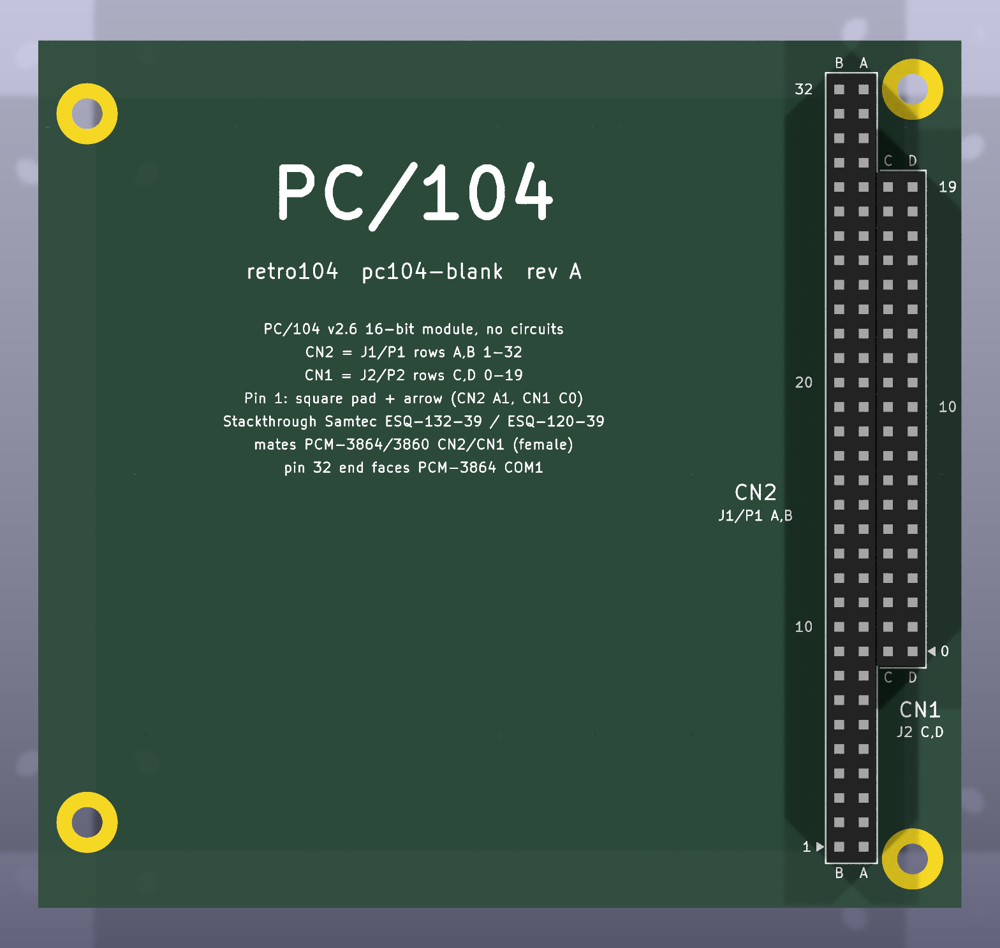
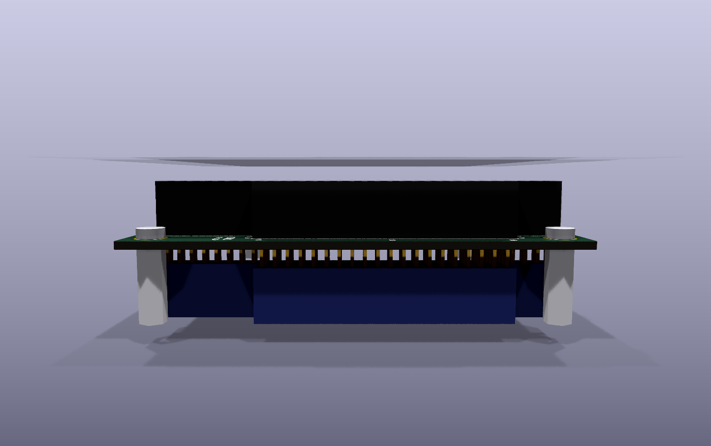

# retro104

Платы расширения **PC/104** (шина ISA 8/16 бит) для ретро-одноплатников. Первый хост —
Advantech **PCM-3860/64 Rev.A1** с видеоконтроллером C&T F65545, то есть вариант **PCM-3864**
(386SX, плата 145 × 102 мм с разъёмами PC/104 CN1/CN2).

| Этап | Плата | Состояние |
|---|---|---|
| 1 | [`pc104-blank`](hardware/pc104-blank/) — пустая механическая ответка | **rev A: ERC 0, DRC 0, контакты сверены 104/104, Gerber проверены. Не изготовлена** |
| 2 | [`pc104-audio`](hardware/pc104-audio/) — звуковая карта на ESS ES1868F (донор BTC 1853L) | **rev A: ERC 0, нетлист сверен, разведена (FreeRouting), DRC 0, Gerber проверены. Не изготовлена** — [docs/pc104-audio.md](docs/pc104-audio.md) |
| 3 | Ethernet | не начата |

**`pc104-blank` — не аудиокарта.** Это электрически пустой модуль PC/104: только площадки разъёмов
CN1/CN2 и четыре крепёжных отверстия. На нём проверяются габарит, отверстия, ориентация и сопряжение
разъёмов с PCM-3864 до проектирования звуковой карты. Следующие платы возьмут из него контур и
библиотеку `hardware/lib`.



## pc104-blank: разъёмы

| Параметр | CN2 | CN1 |
|---|---|---|
| По стандарту PC/104 | J1/P1, ряды A/B, контакты 1–32 | J2/P2, ряды C/D, контакты 0–19 |
| На PCM-3864 (с. 67 руководства) | CN2, 64 контакта | CN1, 40 контактов («Row A/B» = C/D) |
| Разъём | Samtec **ESQ-132-39-G-D** | Samtec **ESQ-120-39-G-D** |
| Тип | проходной (stackthrough): гнездо сверху, штыри снизу | то же |
| Корпус над платой / штырь под корпусом | 11.05 мм / 12.19 мм, квадрат 0.64 мм | то же |
| Шаг, ряды | 2.54 мм, 2 ряда через 2.54 мм | то же |
| Отверстие / площадка | 1.02 мм (Samtec ESQ-SDT) / 1.70 мм | то же |
| Pin 1 (квадратная площадка, стрелка) | A1 | C0 |
| Положение, PC/104 рис. 3 | A: X 0.400 in, B: X 0.500 in; A1 в Y 0.250 in | C: X 0.300 in, D: X 0.200 in; C0 в Y 1.050 in |
| Ключевая позиция стандарта | B10 (у Advantech — GND) | C19 (у Advantech — N/C) |

Плата 3.775 × 3.550 in (95.89 × 90.17 мм), отверстия Ø3.18 мм с площадкой Ø6.35 мм:
(0.200; 0.200), (0.200; 3.350), (3.575; 0.350), (3.575; 3.250) in.

**Переходник не нужен.** Разъёмы PCM-3864 — гнёзда (руководство с. 58–59), а у этой платы снизу
штыри проходных разъёмов. Переходник «male-male» Advantech нужен только модулю, у которого снизу тоже
гнёзда. Конец разъёмов с pin 32 / pin 19 при установке смотрит в сторону COM1 хоста.



## Документация

| Файл | Что внутри |
|---|---|
| [docs/mechanics.md](docs/mechanics.md) | размеры со ссылками на страницы, неоднозначности руководства, сверка с фото, переходник |
| [hardware/pc104-blank/reports/pinout-check.md](hardware/pc104-blank/reports/pinout-check.md) | все 104 контакта: координаты, PC/104 v2.6 и Advantech |
| [docs/manufacturing.md](docs/manufacturing.md) | заказ в JLCPCB, что проверено и что нет |
| [docs/models.md](docs/models.md) | 3D-модели и их ограничения |
| [docs/sources.md](docs/sources.md) | документы, фото, ссылки и лицензионные пометки |
| [docs/pc104-blank-schematic.pdf](docs/pc104-blank-schematic.pdf) | схема (все выводы не подключены) |
| [docs/audio-options.md](docs/audio-options.md) | варианты звуковой карты и решения владельца |
| [docs/pc104-audio.md](docs/pc104-audio.md) | звуковая карта: схема, IRQ/DMA, разъём game/MIDI, первая настройка |
| [docs/pc104-audio-schematic.pdf](docs/pc104-audio-schematic.pdf), [docs/pc104-audio-assembly.pdf](docs/pc104-audio-assembly.pdf) | схема и сборочный чертёж звуковой карты |

Документы производителей лежат в [docs/datasheets/](docs/datasheets/), фото хоста — в
[docs/references/photos/](docs/references/photos/).

## Открыть и пересобрать

Нужен **KiCad 9.0.2 или новее**. Откройте `hardware/pc104-blank/pc104-blank.kicad_pro`.
Библиотека символов, посадочных мест и 3D общая: `hardware/lib/`.

Всё генерируется скриптами: библиотека, схема, плата, отчёты, рендеры, Gerber и проверка.
Пересборка одной командой:

```bash
python tools/make_all.py
```

Цифры механики и таблицы сигналов собраны в `tools/pc104_data.py`, у каждой — ссылка на страницу
документа. Плату строит `tools/build_board.py` через KiCad Python. `tools/check_board.py` сверяет плату
и файлы производства со стандартом независимо от KiCad.

## Структура

```
docs/        документация, datasheets/, references/photos/
hardware/    lib/ (общие символы, футпринты, 3D), pc104-blank/ (проект, reports/, fabrication/)
images/      CAD-рендеры
tools/       генераторы и проверки
```

**Статус: инженерный прототип, не изготавливался и в железе не проверялся.**
