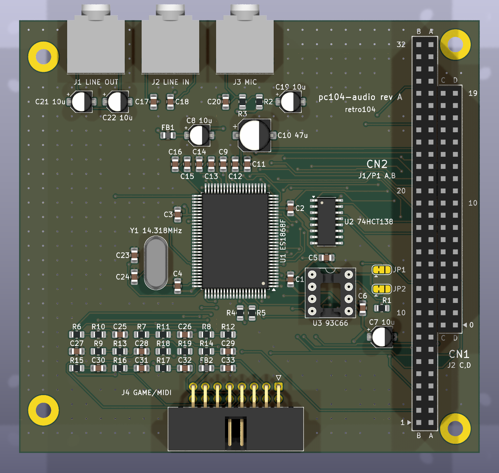

# pc104-audio rev A — звуковая карта PC/104 на ESS ES1868F

Этап 2 retro104. Варианты и решения владельца — в [audio-options.md](audio-options.md).
Схема — [pc104-audio-schematic.pdf](pc104-audio-schematic.pdf), проект KiCad —
[`hardware/pc104-audio/`](../hardware/pc104-audio/).
**Статус: инженерный прототип, не изготавливался и в железе не проверялся.**

## Что на плате

| Узел | Детали | Основание |
|---|---|---|
| Звуковой чип | U1 **ES1868F** (PQFP-100) с донорской BTC 1853L | SB Pro 3.01, ESFM (OPL3), MPU-401, game port; даташит ESS |
| Дешифрация адреса | U2 **74HCT138** (донор: 74LS138) — A15…A12 = 0 и AEN = 0 дают AEN для ES1868 | рис. 28 ESS (U2) |
| Данные PnP | U3 **93C66** в панели DIP-8 (донор: Atmel AT93C66), ORG = GND (512 × 8) | рис. 15 и 28 |
| Выбор источника PnP | JP1 (PSEL1), JP2 (PSEL0 через R1 1 кОм); по умолчанию 1-2 = H = EEPROM | рис. 28 (JP1/JP2, R14), таблица выводов с. 8 |
| Тактирование | Y1 14.31818 МГц HC-49/S, C23/C24 10 пФ | рис. 28 (Y1, C15/C16), с. 56 t14 |
| Питание аналога | FB1 (феррит 0805) от +5 В шины, C8 10 мкФ + C9 0.1 мкФ | решение владельца вместо 78L05 от +12 В |
| Опорное | CMR: C10 47 мкФ + C11 0.1; VREF: C12 0.1 | с. 6, рис. 16, рис. 28 |
| Фильтр ЦАП | FOUT→CIN через C13/C15 0.22 мкФ, на CIN 1 нФ (C14/C16) | с. 28, рис. 17 |
| Линейный выход | J1, AOUT_L/R через C21/C22 10 мкФ | рис. 31 (J8, C36/C37) |
| Линейный вход | J2, C17/C18 0.22 мкФ | рис. 28 (J1, C27/C28) |
| Микрофон | J3, C20 0.1 мкФ; смещение R2/R3 7.5 кОм + C19 10 мкФ от VDDA; кольцо на GND | рис. 28 (J2, R1/R2, C6, C13) |
| Game port | 4 оси: 2.2 кОм последовательно + 0.01 мкФ и 1 МОм на землю; 4 кнопки: 2.2 кОм к +5 В + 0.01 мкФ | рис. 28 (R3–R11, R34–R37, C18–C26) |
| MIDI | MSO/MSI через 2.2 кОм на разъём game/MIDI | рис. 28 (R12/R13) |
| Разъём game/MIDI | J4 угловой IDC 2 × 8 под стандартный кабель на планку DB-15; питание через FB2 + 150 пФ | AN-1130 с. 1; рис. 28 (L1, C22) |
| Шина | CN2 = PC/104 J1/P1, CN1 = J2/P2 — проходные Samtec ESQ-132-39 / ESQ-120-39 | как на pc104-blank |

Нет на плате (решения владельца): усилителя, входа CD, IDE, модема, разъёма wavetable, кнопок
громкости. Неиспользуемые выводы ES1868 оставлены свободными, как на рис. 28: входы AUX подтянуты
к CMR внутри чипа, входы DSP и wavetable — к земле внутри чипа. CDIRQ и GPI притянуты к земле
резисторами R5/R4 10 кОм.

Отступление от даташита, замеченное при ERC: в таблице выводов ES1868 (с. 7) SEDI/VOLUP значится
входом. Но в режиме EEPROM этот вывод подаёт данные на вход DI микросхемы 93C66 (рис. 15 и 28) и
позволяет её записывать. В символе он поэтому двунаправленный.

## Шина, IRQ и DMA

Раскладка повторяет эталон ESS (рис. 28/29). Её же объявляет EEPROM типовых карт на ES1868
(заголовок `A5 59 A7 CB 10 53`). Значит, 93C66 с донора подходит без перепрошивки — если донор
сделан по эталону; это проверяется при приёмке донора.

| ES1868 | IRQA | IRQB | IRQC | IRQD | IRQE | IRQF | DRQA/DACKA | DRQB/DACKB | DRQC/DACKC | DRQD/DACKD |
|---|---|---|---|---|---|---|---|---|---|---|
| Линия ISA | 9 | 5 | 7 | 10 | 11 | 12 | 0 | 1 | 3 | 5 |
| Контакт PC/104 | B4 | B23 | B21 | D3 | D4 | D5 | D9/D8 | B18/B17 | B16/B15 | D11/D10 |

Адрес: SA0–SA11 на ES1868, SA12–SA15 на U2. Данные SD0–SD7 (8-битное устройство).
Строб IOR/IOW, RESET, +5 В (B3, B29, D16), земля (A32, B1, B31, B32, C0, D0, D18, D19).
У PCM-3864 нет PS/2-мыши: в CN6 контакты 2 и 6 не подключены (руководство, с. 64), поэтому IRQ12 свободна.

Рекомендуемые ресурсы на PCM-3864: SB **220h, IRQ5, DMA1**, MPU-401 **330h**, FM **388h**, джойстик **201h**.
LPT хоста перевести на IRQ7, DMA ECP — на 3 или режим SPP (руководство PCM-3864, с. 16).

## Разъём game/MIDI (J4)

Угловой IDC 2 × 8: вертикальный с надетым кабелем выше допуска PC/104 по высоте (11.05 мм).
Стоит на нижнем крае — это зона выступа разъёмов по рис. 3 стандарта. Раскладка — стандартный
16-контактный разъём материнских плат (National AN-1130, с. 1). Подходит обычный кабель с планкой
DB-15: провод n попадает на контакт DB-15 по схеме 1-1, 2-9, 3-2, 4-10 …

| J4 | Сигнал | DB-15 | J4 | Сигнал | DB-15 |
|---|---|---|---|---|---|
| 1 | +5 В (FB2) | 1 | 2 | +5 В | 9 |
| 3 | кнопка A1 (SWA) | 2 | 4 | кнопка B1 (SWC) | 10 |
| 5 | ось A X (TA) | 3 | 6 | ось B X (TC) | 11 |
| 7 | GND | 4 | 8 | MIDI OUT (MSO) | 12 |
| 9 | GND | 5 | 10 | ось B Y (TD) | 13 |
| 11 | ось A Y (TB) | 6 | 12 | кнопка B2 (SWD) | 14 |
| 13 | кнопка A2 (SWB) | 7 | 14 | MIDI IN (MSI) | 15 |
| 15 | +5 В | 8 | 16 | ключ, не подключён | — |

`tools/audio_design.py` при каждом запуске сверяет эту таблицу с разъёмом DB-15 на рис. 28 ESS.

## Гнёзда 3.5 мм

Same Sky (CUI) SJ1-3523N: 1 — sleeve (GND), 2 — tip (левый канал), 3 — ring (правый канал).
Передняя грань корпуса стоит на краю платы, втулка Ø6 мм выступает наружу. Верхний край — тоже
зона выступа разъёмов по стандарту. При установке на PCM-3864 он смотрит в сторону COM1, то есть
к разъёмам хоста. Высота гнезда около 6 мм.

Футпринт KiCad для SJ1-3523N исправлен по даташиту (с. 2):
- пазы выводов 0.8 × 1.5 мм вместо 0.4 × 1.4 мм;
- удалён вырез Edge.Cuts: при корпусе на краю он не нужен.

## Первая настройка (план, не проверено)

1. Перед пайкой проверить донорскую BTC 1853L в обычной ISA-машине — владелец делает это сам.
2. Пайка: ES1868F с донора (фен, флюс), EEPROM 93C66 — в панель, кварц HC-49/S 14.31818 МГц.
   Высокий донорский кварц HC-49/U (13.5 мм) стоя не проходит по высоте PC/104 — только лёжа.
3. Перемычки JP1/JP2 оставить в 1-2 (EEPROM).
4. DOS: `ESSCFG` с донорской дискеты драйверов или `UNISOUND`. Переменная `BLASTER` — по выбранным
   ресурсам, например `SET BLASTER=A220 I5 D1 P330 T5 J201` (так в README hkzlab/ES1868_ISA8).
   В BIOS PCM-3864 LPT — на IRQ7.
5. Windows 95 найдёт карту через PnP и драйвер ESS (theretroweb, см. sources).

## Что проверено

| Проверка | Результат |
|---|---|
| ERC схемы | 0 ошибок, 0 предупреждений ([erc.rpt](../hardware/pc104-audio/reports/erc.rpt)) |
| Нетлист против `tools/audio_design.py` | 90 цепей, 288 выводов, 81 неподключённый, 0 расхождений ([netlist-check.txt](../hardware/pc104-audio/reports/netlist-check.txt)) |
| Трассировка FreeRouting 2.5.0 | 198 соединений, 0 неразведённых, 0 нарушений; оптимизатор отключён (в пробном прогоне 6 мин без улучшений) |
| Доводка после импорта | 153 сужения у выводов (75 % ширины класса) расширены до 0.2 мм; 14 дорожек/переходных уменьшены на 1–5 мкм до зазора 0.2 мм; 304 сшивающих переходных GND |
| DRC + соответствие схеме | 0 нарушений, 0 неподключённых, 0 ошибок футпринтов ([drc.rpt](../hardware/pc104-audio/reports/drc.rpt)) |
| Файлы производства | контур, CN1/CN2 (104/104) и H1–H4 по стандарту, 592 PTH + 15 NPTH совпадают с платой ([fab-check.md](../hardware/pc104-audio/reports/fab-check.md)) |
| Шелкография | `tools/audio_silk.py`: подписи не ближе 0.2 мм к площадкам и друг к другу, не на чужих корпусах; DRC без нарушений шелкографии; рендеры верха и низа просмотрены целиком |

Классы цепей: сигналы 0.25 мм, переходные 0.7/0.3 мм; +5V, +5VA, +5VJ — 0.4 мм, переходные 0.8/0.4 мм;
GND — заливки с двух сторон и сшивка. Земля общая, без разделения на аналоговую и цифровую. На
двухслойной плате это ближе всего к рекомендации ESS (прил. C): аналоговые дорожки между земляными
полигонами, аналоговые детали собраны у гнёзд.

Не проверено: работа в железе, DFM на стороне JLCPCB, шумы аналогового тракта, совпадение стоек
с отверстиями PCM-3864, реальная раскладка IRQ/DMA в EEPROM донора.

